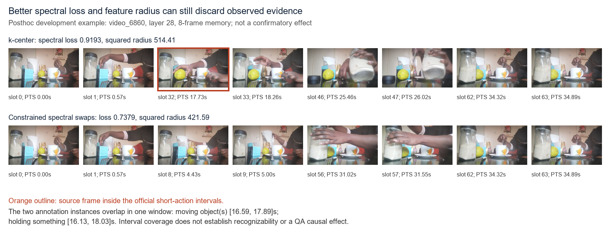

# 下一轮诊断：短动作覆盖失败来自哪里

结论：**当前证据更支持“重构目标与短动作证据保留不一致”，不支持“只要优化得更好就能解决”。** k-center 半径约束可以保住同一隐藏空间的最坏距离，却不能保住动作实例。受约束交换在开发层 0 有局部改善，但层 14/28 没有一致优势；不应据此启动新的确认集。

本诊断仅使用原 8 个开发视频、71 个官方动作、已存的层 0/14/28 隐藏态和 64 帧图像。没有读取确认集逐题 QA 文件，没有将确认集视频或动作用于方法选择，没有修改冻结的 `memory_selection.py`。确认集覆盖的已冻结负结果仅作为问题背景：B4 的短动作视频宏平均 spectral=28.34%，k-center=32.44%，centered-time=22.88%，两项主要对比区间均跨 0。

随后收到主实验执行者提供的首轮 Qwen 确认汇总：spectral 相对 k-center 为 −8.08 个百分点，95% 区间 [−19.70,+2.02]；相对 centered-time 为 −2.27 个百分点，区间 [−10.61,+4.55]。该汇总进一步限定当前方案未获支持，但没有进入本次开发选择器、候选排序或参数调整。以下新方案仍只接受原 8 视频开发评价，不能用它们改写首轮确认的失败。

## 1. 观察与表征瓶颈应分开

开发集有 20 个持续时间不超过 2 秒的动作，其中 19 个在 64 个实际源帧中至少命中一次。14 个动作包含至少一个“两张源帧均落在动作区间内”的完整 pair；另外 5 个可观察短动作只出现在混合 pair 中，即一张在动作内、一张在动作外。

| 短动作证据层次 | 实例数 |
| --- | ---: |
| 官方全部短动作 | 20 |
| 原始 64 帧中至少一张源帧命中 | 19 |
| 原始 64 帧中没有源帧命中 | 1 |
| 存在完整、不同源帧的动作内 pair | 14 |
| 可观察，但仅存在动作/非动作混合 pair | 5 |
| pair 中点时间落入动作区间 | 20 |

最后一行不能当作可观察证据：`video_1580:action:9` 的拍手区间是 1.132995–1.532876 秒，没有实际源帧落入；pair 1 的中点却在区间内。中点时间可能制造“已经观测动作”的假象。后续覆盖必须继续使用源 PTS。

隐藏序列只有 32 个时间位置，间隔为 0.811–1.112 秒。每个位置混合相邻两张输入帧，不是独立单帧编码。即使 pair 保留了动作帧，其特征仍可能被另一张帧的内容或更广的视觉上下文影响。以上 5 个混合 pair 案例说明存在混合风险，不能直接断言动作信息已经消失。

每个时间位置还把 60 个空间 token 做平均，得到一个 2048 维向量。平均映射必然不保留完整空间分布：两个位置的变化分别为 `+v` 和 `-v` 时均值不变。但本次缓存没有保存平均前的 token，**无法从现有数据测出实际丢失了多少动作证据，也无法证明未平均特征能够恢复任务表现**。

## 2. 各层有动态信号，但高频不等于短动作

频率统计使用与选择器相同的去均值、boxcar、Parseval 加权 rFFT；三个频带是 `(0,1/8]`、`(1/8,1/4]`、`(1/4,1/2]` cycles/pair sample。以下是 8 个视频的平均比例，不与此前 Hann/物理 Hz 统计混用。

| 层 | 低频动态能量 | 中频动态能量 | 高频动态能量 | 动态能量/原始能量 |
| ---: | ---: | ---: | ---: | ---: |
| 0 | 58.29% | 17.69% | 24.01% | 1.83% |
| 14 | 65.16% | 15.96% | 18.88% | 2.30% |
| 28 | 57.87% | 18.45% | 23.69% | 3.63% |

这些比例说明隐藏轨迹有可测动态；不能跨层把原始能量比例解释为语义信息量，因为层的尺度、偏置及归一化不同。

在每个视频内计算后向隐藏差分与图像变化的 Spearman 相关，再跨视频平均：

| 层 | 与整幅灰度变化相关 | 与局部最大 patch 变化相关 |
| ---: | ---: | ---: |
| 0 | 0.478 | 0.325 |
| 14 | 0.634 | 0.490 |
| 28 | 0.582 | 0.459 |

图像诊断把每张图缩到 64×64 灰度、两张图平均成 pair，然后比较相邻 pair；局部指标取 8×8 patches 中的最大均方变化。它只是独立像素代理，既包含相机/光照变化，也不等同于真实模型的时序融合。这里没有证明空间平均造成错误；只说明现有差分与全局画面变化的联系强于该局部极值代理。

把每个频带逆变换回时间轴后，比较动作支持 pair 上的平均能量与全视频平均能量。19 个可观察短动作的中位高频富集比，在层 0/14/28 分别为 **0.898 / 0.839 / 0.925**，均未超过 1。低/中频的中位富集比也未超过 1。短动作并不普遍对应高频能量峰，至少当前定义和这组开发样本不支持这样的假设。

逆频带信号有全局支撑，上述“富集”不意味着能量由该动作因果产生；重叠动作也会重复使用同一时间位置。诊断同时保存最大隐藏差分分位数，但不直接比较长短动作的最大值作为证据——长动作天然有更多机会包含最大峰。

## 3. 贪心优化误差不是主要解释

T=32、B=4 且首尾固定时，只有 `C(30,2)=435` 个候选集合。本次在 24 条开发轨迹上对它们全部枚举，用相同候选空间分别求：

1. 原相位多频带相对重构目标的全局最小值；
2. centered-time 插值残差 MSE 的全局最小值；
3. 在初始 k-center 半径内，上述两个目标的受约束全局最小值。

动作标签不进入目标、可行性约束或选择排序，只用于评价输出集合；并列时按目标值后按索引字典序取最早集合。

| 层 | spectral 贪心相对最优差距：中位/最大 | centered-time 贪心相对最优差距：中位/最大 |
| ---: | ---: | ---: |
| 0 | 0.00% / 1.80% | 0.00% / 1.40% |
| 14 | 0.21% / 2.22% | 0.00% / 3.18% |
| 28 | 0.22% / 3.15% | 0.00% / 2.94% |

更好的目标优化没有带来稳定的更好动作覆盖。下表为 B4 的可观察短动作视频宏平均，分母固定为 7 个有可观察短动作的视频、19 个事件。

| 层 | k-center | spectral 贪心 | spectral 全局 | 半径约束 spectral 交换 | 半径约束 spectral 全局 | centered 贪心 | centered 全局 | 半径约束 centered 交换 | 半径约束 centered 全局 |
| ---: | ---: | ---: | ---: | ---: | ---: | ---: | ---: | ---: | ---: |
| 0 | 27.38% | 23.81% | 32.14% | 35.71% | 32.14% | 23.81% | 28.57% | 27.38% | 32.14% |
| 14 | 34.52% | 30.95% | 34.52% | 30.95% | 38.10% | 38.10% | 38.10% | 38.10% | 38.10% |
| 28 | 40.48% | 38.10% | 38.10% | 34.52% | 34.52% | 38.10% | 38.10% | 38.10% | 38.10% |

层 28 的 spectral 全局最优仍保留 8/19 个可观察短动作，与贪心相同；k-center 保留 9/19。受半径约束的 spectral 全局最优降为 7/19。层 0 的交换表现较好，但不能选择这一层作为“方法已有效”的依据；层间结果不稳定，样本也只有 19 个可观察短动作。

每个视频 435 个候选集合中，重构误差和短动作命中率的相关并不稳定地为负。例如 spectral 的视频相关中位数在层 0/14/28 为 +0.266/+0.059/+0.108；误差较小不系统对应命中较多。这些集合高度重叠，相关仅为描述，不计算独立样本显著性。

## 4. 半径约束交换合理在哪里，边界在哪里

交换从同预算、首尾固定的 k-center 集合启动。每轮枚举“移除一个内部锚点、加入一个未选锚点”，只接受满足 `r(S) <= r(S_kcenter)` 且严格降低指定目标的交换；最优并列选择更早索引。半径使用同一完整隐藏轨迹的欧氏最大最近邻距离。最多 30 轮；全部开发运行均到达单次交换局部最优，最终半径都不超过初始半径。

它的合理用途是：在不恶化当前特征空间最坏覆盖的条件下，尝试改善时间重构。它不能保证动作覆盖，原因有三：

- 半径控制的是隐藏空间距离，不是动作、顺序或可读性。若短动作特征接近普通背景，就可在半径不变甚至更好的情况下遗漏。
- 约束不覆盖原 64 帧本来没观测到的动作；平均后的隐藏距离也不约束未保存的空间细节。
- 固定首尾 B4 只有两个自由锚点，可能主要补偿长状态和全局运动；频带相对归一并未给稀有事件设置单独的保留约束。

有一个可以精确证明的充分条件：若某动作支持的候选集合 `A` 与所有非动作候选的距离都严格大于允许半径 `rho`，任何满足半径约束的集合必须包含一个 `A` 锚点，否则 `A` 中点的最近距离会超限。但在本次 19 个可观察短动作×3 层的 57 个实例中，仅 4 个满足该条件；它们全是支持 pair 0 的开头动作，原本已被固定端点保证，未提供新增的内部短动作保障。条件不成立不意味着必然丢失，只意味着此证明不能提供保证。

开发集存在直接反例：`video_6860`，层 28、B4，spectral 交换把谱目标从 **0.9193 降到 0.7379**，k-center 平方半径也从 **514.41 降到 421.59**，却丢掉 k-center 原本保留的两个官方短动作实例 `action:4` 和 `action:11`。这两个标签分别是 Moving objects（16.593–17.893 秒）与 Holding something（16.127–18.026 秒），时间高度重叠，属于**同一证据窗口的两个标注实例，不是两个独立时段或独立重复**。该反例仍说明“重构更好＋半径更小”不能推出标注动作证据覆盖更好。

图中橙框仅表示实际源 PTS 落入官方动作区间，不证明动作被看清或正确识别，也不是 QA 因果证据。图像与时间映射来源保存在 `outputs/next_iteration_diagnostics/proxy_counterexample_sources.json`。

## 5. 下轮优先做表征诊断，不升级确认

当前不建议把约束交换当作下一版已成立的方法，也不建议对同一确认集再次调层、频段、半径松弛或短动作阈值。可以在原 8 个开发视频上继续实际读出，直接比较层 0 的约束 spectral 与约束 centered-time，并完整保留所有问题和方法；如果没有净改善，应停止这一分支。该开发检查不升级为新的确认结论。更有机制价值的后续工作仍应留在开发集：

1. 只为原 8 视频补存空间平均前的 token，比较 mean、局部统计/区域特征是否能区分那 5 个混合 pair 动作。先验证表征中有可读证据，再优化选择目标；不要用官方动作边界作为实际选择器输入。
2. 分开比较 64 个单帧编码和 32 个双帧融合的观测分辨率，记录额外提取成本。若动作在源帧中出现而表征不可分，频域重加权无法恢复丢掉的信息。
3. 对全部开发短动作检查“单个源见证片段能否被读出模型识别”，而非仅验证字母 OCR。官方标注可用于离线诊断定位，但这种有标签的见证读出只用于测可读上限，不能作为 query-free 方法收益。
4. 若表征确有短动作证据，再考虑面向局部变化/可覆盖状态的目标；保留 k-center、差分、centered-time 和同预算时间覆盖作为强对照。仍需新的、未被方法选择使用的数据作下一次确认。
5. 若补存空间 token或提高观测密度后仍未形成稳定优势，保留负结果：短视频外部记忆的频谱重构保真不能自动转化为动作证据与任务保真。

## 6. 产物与复核

### 可直接读出的层 0、B4 开发记忆

独立模块 `spectral_memory/memory_refinement.py` 已把 8 个视频×10 方法的选集实际持久化为 NPZ。读出入口为 `outputs/spectral_refinement_dev/memories.jsonl`，兼容现有 `memory_study.evaluate`。它没有导入动作标注、QA 或开发诊断结果来选帧；仅根据隐藏轨迹和原始帧清单重算选择，并验证帧字节与原提取哈希相同。

全部方法保留 4 pairs/8 帧、相同首尾，在同一视频内持久化字节数相等。每个视频对两个目标共享完整 435 集合的目标表，两个交换策略也在该表上检索可行邻居。共享建表计算用于此开发对照，不代表精简部署时的单独方法耗时。

下表的目标值是 8 视频的平均值；覆盖率是有可观察短动作的 7 视频宏平均。谱目标与时域 MSE 单位不同，不能直接比较两列数值大小。

| 方法 | 短动作宏覆盖 | 保留/可观察实例 | 平均谱目标 | 平均 centered-time MSE |
| --- | ---: | ---: | ---: | ---: |
| uniform | 23.81% | 5/19 | 0.879022 | 0.00180003 |
| kcenter | 27.38% | 6/19 | 0.915103 | 0.00199047 |
| spectral_balanced | 23.81% | 5/19 | 0.793914 | 0.00156798 |
| temporal_centered | 23.81% | 5/19 | 0.794124 | 0.00154110 |
| spectral_exact | 32.14% | 7/19 | 0.790464 | 0.00155991 |
| temporal_centered_exact | 28.57% | 6/19 | 0.795126 | 0.00153768 |
| kcenter_swap_spectral | 35.71% | 8/19 | 0.806422 | 0.00159168 |
| kcenter_swap_centered | 27.38% | 6/19 | 0.808957 | 0.00158343 |
| kcenter_radius_exact_spectral | 32.14% | 7/19 | 0.804103 | 0.00158262 |
| kcenter_radius_exact_centered | 32.14% | 7/19 | 0.806708 | 0.00158045 |

层 0 的约束谱交换覆盖高于约束 centered 交换，但两者还未在这里展示真实 QA 净收益；受约束全局最优两者覆盖相同。读取后的任务结果应单列为开发结果，不能替代失败的首轮确认。

- `outputs/spectral_refinement_dev/candidate_objectives.jsonl`：8×435=3480 个全部候选集合及双目标、半径，便于审计相同候选空间。
- `outputs/spectral_refinement_dev/objective_summary.json`：各方法双目标与半径的均值。
- `outputs/spectral_refinement_dev/validation.json`：80 个 payload 全部通过现有读出加载器；80 个选集与先前独立开发枚举完全一致。
- 重建命令：`.venv-cuda\Scripts\python.exe -m spectral_memory.memory_refinement --frames-manifest data\perception_test_frames64\frames.manifest.jsonl --hidden-manifest outputs\qwen3_hidden_pilot\manifest.layer_0.jsonl --output-dir outputs\spectral_refinement_dev_new`。

### 原始诊断产物

- `outputs/next_iteration_diagnostics/diagnostics.json`：24 条轨迹、71 个动作的源帧/pair几何、像素/隐藏变化、频带统计、576 个方法选择及每个事件是否保留。
- `outputs/next_iteration_diagnostics/exact_budget4.json`：435 候选×24 轨迹、两类目标的全局最优差距、约束可行集大小、选择集合及事件分离充分条件。
- `outputs/next_iteration_diagnostics/analyze_development.py` 与 `exact_budget4_audit.py`：仅 CPU、显式开发集输入；所有输入与冻结选择器的 SHA-256 保存在结果中。
- 从仓库根运行 `.venv-cuda\Scripts\python.exe -m outputs.next_iteration_diagnostics.analyze_development` 和 `.venv-cuda\Scripts\python.exe -m outputs.next_iteration_diagnostics.exact_budget4_audit` 可重算。此过程不运行模型、不访问确认 QA。
