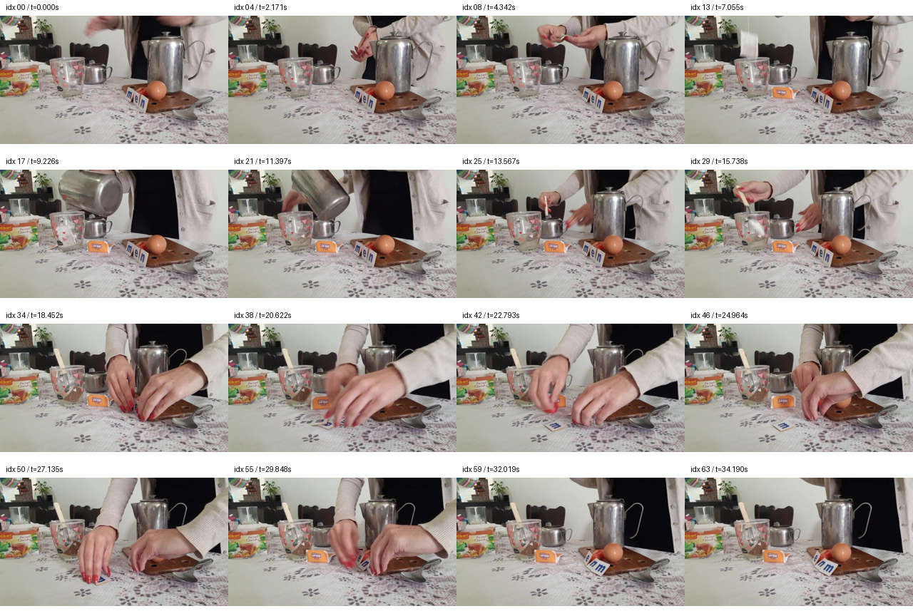
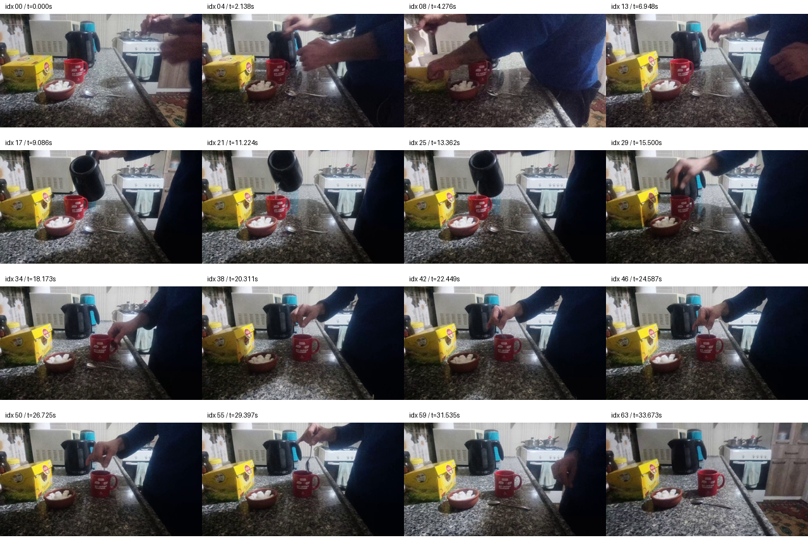

# 真实问题审计：短视频状态证据与受限外部记忆

审计对象是 8 个已用于开发的视频、36 道官方选择题，以及新增的 66 条配对帧读出诊断。它们用于发现问题和检查实验设计，不能作为独立确认集。这里没有修改原始严格判分，也没有把格式失败改写为记忆失败。

当前可支持的问题表述是：**相同读出模型在有限视觉上下文中，可能无法正确使用已经出现的末态证据；均匀稀疏采样也可能完全漏掉短暂动作。** 当前结果尚未证明频域选择能解决这些问题，也未证明重复历史是单一原因。

## 1. 可复查的证据

- 原始逐题回答：`outputs/qwen3_qa36_pilot/records.jsonl`。
- 原始问题和动作：`data/perception_test_sample/questions.jsonl`、`actions.jsonl`。
- 完整 64 帧时间及源帧映射：`data/perception_test_frames64/frames.manifest.jsonl`。
- 完整逐题分类、71 个动作的实际源帧时间覆盖、官方裁剪检查和配对帧实验摘要：`outputs/observed_problem_audit/observed_problem_audit.json`。
- 重算脚本：`outputs/observed_problem_audit/analyze_observed_problem.py`。
- 新增配对帧读出记录：`outputs/matched_tail_readout/records.jsonl`。

重算方式：从仓库根目录运行 `.venv-cuda\Scripts\python.exe outputs\observed_problem_audit\analyze_observed_problem.py`。该脚本只用 CPU，仅读取实验记录，不修改评分。JSON 保存输入文件的 SHA-256。动作覆盖用解码视频的实际帧时间与官方时间区间比较，不把重采样网格的目标时间误当成真实解码时间。

原 8 个视频按各自 train/valid split 查询官方 `cut_frame_mapping`，结果全部为 `-1`，不存在此映射要求裁去的后缀。不能仅以 `is_cup_game=0` 推断视频无须裁剪；本次结论来自逐视频映射检查。

## 2. 先分离格式失败和内容失败

| 原始条件 | 严格正确 | 格式失败 |
| --- | ---: | ---: |
| no_memory | 13/36 | 0 |
| first_half | 20/36 | 6 |
| last_half | 21/36 | 4 |
| uniform_full | 19/36 | 5 |

`uniform_full` 的 17 个错误中，5 个是严格单字母解析失败，4 个是输出格式有效且某个局部采样条件答对的案例，8 个是在所有条件中均未被纠正的案例。另有 11 题是有视觉条件答对而无视觉条件答错，8 题在完整采样及无视觉条件中均答对。这个分类描述观测，不是已确定的认知机制标签。

例如 `A. a tea` 和 `C. static or shaking` 违反原先冻结的单字母输出规则。它们仍在主分数中计错；已有宽松解析敏感性结果必须单列，不能用于挑选“记忆退化”案例。后续研究采用单 token 的受限选项解码，这改变了读出协议，因此新旧结果不能无条件混为同一实验。

## 3. 主案例：末态可见，却输出初态

视频 `video_1580`，问题 `perception_test:video_1580:mc:2`：

> What is the order of the letters at the end?

选项 A=`men`、B=`enm`、C=`nme`，官方答案 B。原始四种条件的输出依次为：

| no_memory | first_half | last_half | uniform_full |
| --- | --- | --- | --- |
| C，错 | A，错 | B，对 | A，错 |

原始 `uniform_full` 的采样序列位置为 `[0,4,8,13,17,21,25,29,34,38,42,46,50,55,59,63]`。这些位置是 64 帧重采样输入中的位置，不是 MP4 原视频帧号。在接触表中，前半段多次呈现 `men`，后段位置 59 和 63 已清晰呈现最终 `enm`。因此，“没有采到最后状态”不能独立解释此错答。

对应的开头顺序问题 `video_1580:mc:3`，first_half 和 uniform_full 答对初态 `men`，last_half 错选末态 `enm`。但 no_memory 也答对开头题，所以不能据此声称已测到可靠的视觉初态记忆。

该视频唯一被官方标为 `area=memory` 的同序判断题 `mc:1` 在包括 no_memory 的全部条件下均答对。这一道题不能证明外部记忆有用。更困难的变化字母计数题 `mc:0` 在全部条件下仍错，说明状态比较和关系推理也可能成为瓶颈。

### 已完成的固定尾部检验：没有证实重复历史机制

为消除采样帧被重新组合成非相邻时序块的混杂，新实验以连续两帧组成候选 pair：隐藏行 `g` 对应重采样序列位置 `[2g,2g+1]`。每个正常条件保留 8 pairs，即 16 帧；所有保留片段按时间排序。

| 条件 | 前文 pair 索引 | 完全相同的固定尾部 |
| --- | --- | --- |
| tail2_old | 0,3,6,9,12,15 | 30,31 |
| tail2_uniform | 0,6,12,17,23,29 | 30,31 |
| tail2_recent | 16,19,21,24,26,29 | 30,31 |
| tail4_old | 0,5,10,15 | 28,29,30,31 |
| tail4_uniform | 0,9,18,27 | 28,29,30,31 |
| tail4_recent | 16,20,23,27 | 28,29,30,31 |

这些前文条件全部按时间定义，未使用答案或动作 GT 定位。正常 pair_uniform 为 `[0,4,9,13,18,22,27,31]`。单末尾 pair `[31]` 是额外的可读性参考，仅有 2 帧，不能算作等预算比较。

实际结果：最终字母题上，以上 6 个固定尾部条件、pair_uniform、pair last_half、pair first_half 全部输出 A；只有单末尾 pair 参考输出 B，其三选项内概率为 0.4442。tail2_old/tail2_recent 的正确选项概率分别为 0.0188/0.1327，但 top-1 都错，不能将概率变化当成任务已被解决或多次独立重复的显著效果。

这说明单末尾证据在该读出设定下可以被识别，加入上下文后可能发生错误读出；但比较同时改变了帧数与上下文组成。等预算固定尾部对照未能将错误专门归因于旧状态重复。原始 last_half 的优势也没有在新的 pair 采样及受限解码协议中复现。因此不能写成“重复历史干扰已被证明”，更不能写成“频域机制已得到验证”。

原记录的 `budget_pairs=8` 对单末尾参考表示请求的分组预算字段，其实际保留量为 `len(selected_pairs)=1`；独立审计明确记录 `actual_retained_pairs`，避免错误比较。正常同视频 8-pair 条件持久化大小均为 7,078,860 bytes，单末尾参考为 885,540 bytes。

## 4. 次要案例：短暂证据丢失与视觉识别混杂

| 问题/动作 | 官方动作区间（秒） | first_half 内帧数 | last_half 内帧数 | uniform_full 内帧数 | 可以支持的结论 |
| --- | --- | ---: | ---: | ---: | --- |
| video_10993，拍手 | 0.371515–1.891350 | 1 | 0 | 0 | 完整范围的均匀稀疏采样确实错过动作 |
| video_2564，切东西 | 6.243901–14.090515 | 7 | 0 | 4 | first_half 对而 uniform_full 错，不能归为完全缺失证据 |
| video_3501，敲击水壶 | 17.861399–20.127397 | 0 | 2 | 1 | last_half 对而 uniform_full 错，与证据密度相容但未确定机制 |

上述帧数是实际解码时间落入官方区间的数量，未证明单帧包含足以识别动作的画面。

`video_10993:mc:2` 在全部条件下都答错，即使 first_half 已包含 1.080789 秒的一帧。均匀采样漏帧是具体问题，但“补上一帧即可解决”还没有证据；持续动作可能需要连续见证片段。

`video_2564:mc:3` 的 no_memory 也答对，因此 first_half 的正确不能直接视为视觉证据收益。`video_3501:mc:3` 的 no_memory 和 first_half 也答对，而 first_half 没有任何落入官方敲击区间的帧。这是语言先验、选项结构或猜测能造成正确答案的直接提醒。

`video_1580:mc:5` 只有原始 last_half 判断冷水正确，但温度和“看不到蒸汽”的视觉依据不可靠，暂不作为主记忆案例。

## 5. 可检验的方法：相位保留的多频带相对重构

实现位于 `spectral_memory/memory_selection.py`。输入为可用观察前缀内、均匀时间网格上的隐藏轨迹 `X ∈ R^(T×D)` 与时间戳，候选是相邻原输入帧对。方法不接收问题、答案、动作边界或 QA reward。它需要先观察所提供的完整前缀；不是已经实现的逐帧有限状态在线算法，也不等于修改旧缓存的因果干预。

给定所选锚点集合 `S`，在原时间轴上分段线性插值得到 `X_hat(S)`。先各自去均值，再计算不加窗的正交归一 rFFT。对三个固定频段 `(0,1/8]`、`(1/8,1/4]`、`(1/4,1/2]`，目标为：

$$
J_{\mathrm{phase}}(S)=\frac{1}{3}\sum_{b=1}^{3}
\frac{\sum_{k\in b}w_k\|F_k(X)-F_k(\widehat X(S))\|_2^2}
{\sum_{k\in b}w_k\|F_k(X)\|_2^2+0.01\sum_{k>0}w_k\|F_k(X)\|_2^2}.
$$

`w_k` 是单边 Parseval 权重：一般正频率为 2，偶数长度时 Nyquist 为 1，DC 为 0。频段单位是 **cycles per hidden-pair sample**；随视频长度不同而映射到不同物理 Hz，返回元数据中保存本视频对应的 Hz 边界。所有三个固定频段均参与平均；极短序列中没有频率 bin 的频段贡献 0。常量轨迹约定误差为 0。

算法固定保留首尾 pair，然后逐次枚举所有尚未保留的 pair，加入使目标最小者，直到达到预算；数值相等时选更早位置。这是贪心求解，没有全局最优保证，新增锚点也不被声称必然使每个频段误差单调减少。

FFT 是可逆坐标变换，不能生成原时域没有的信息。本方法的可检验差异来自“各频段相对归一的误差权重＋保留相位＋固定存储预算”，不是“高频天然更有记忆价值”。如果同样的时域线性滤波加权目标产生同等效果，应承认它是等价表述，而非频域独立信息。

去均值会排除 DC/平均状态误差；端点也不能保证平均语义完全保真。本轮保留预先约定的目标，并单列 `mean_state_squared_bias`，不追加利用开发结果调过的共享均值锚点，不声称保留了全部语义。

### 强对照与边界

| 方法 | 规则 | 是否需要隐藏态 |
| --- | --- | --- |
| uniform | 均匀取 pair，含首尾 | 否 |
| recent | 最近连续 B pairs；不强制开头 | 否 |
| random | 首尾＋有种子的随机内部 pair | 否 |
| temporal_difference | 首尾＋最大的后向隐藏差分 | 是 |
| kcenter | 首尾启动，选离当前集合最远的隐藏态 | 是 |
| temporal_reconstruction | 贪心最小化原时域总 MSE | 是 |
| spectral_balanced | 复数傅里叶相对多频段误差 | 是 |
| spectral_power | 同频段、同归一规则，比较逐通道幅值差，去除相位 | 是 |

`spectral_power` 是幅值差的平方，不是功率平方差；保留原始隐藏通道坐标。复数目标、时域目标和欧氏距离用 Gram 特征坐标加速。若 `ZZ^T=XX^T`，对任意时间线性算子 `A` 有 `||AX||_F²=tr(AXX^TA*)=||AZ||_F²`，故这些范数在数值误差范围内等价。逐通道幅值差不满足此旋转不变性，因此不能把 Gram 坐标用于该消融。

每次调用都在原维重新计算最终诊断并核对 Gram 等价性。CPU 数值检查覆盖 T=2/3/8/32、D=1/7、常量、非法时间/预算/非有限数、所有锚点精确重构、随机复现、逐步原通道穷举比对，以及 8 视频×3 层×8 方法的 192 个真实选择。最大 Gram 相对残差为 `2.49e-15`，最大复数目标差为 `3.00e-15`。另有独立代理的 112 个边界组合检查通过。数值正确性不代表下游 QA 有效。

记录见 `outputs/observed_problem_audit/memory_selection_numeric_validation.json`。选择耗时包含共用 Gram 和完整诊断开销；前三种不使用特征的方法在部署时不需要隐藏提取或这些诊断。需要分别报告必要观察成本、选择审计时间、持久化字节及读出 token/时间，不能向简单基线强加额外隐藏提取成本。

## 6. 下一阶段怎样支持或否定研究假设

1. 用独立于这 8 个开发视频的数据冻结层、频段、预算、读出协议、主比较和主要题型；不以开发题的正确率重新挑选方法或案例。
2. 每个同视频同预算方法使用相同 pair 单位、分辨率、真实持久化格式和相同读出模型。查询时只读写入后的记忆文件。单末尾/full 参考单独展示实际 pair 数，不混入同预算主比较。
3. 首要比较应是相位相对频带目标对时域重构及幅值消融的任务增益，并同时检查 uniform、recent、差分和 k-center。重构变好但 QA 没变好属于有效负结果。
4. 分开报告静态语义、短暂动作、初末状态及官方 memory 子集；no_memory 已正确的题不应被描述为新的记忆能力。多个随机种子用于 random 策略，确定性读出无需伪造重复独立试验。
5. 原视频为配对统计单元；没有参与者标识时不能声称跨人的独立泛化。短视频外部事件记忆也不能直接外推为长期持续多模态记忆。
6. 如果单末态参考能读对、所有合理等预算选择仍读错，优先将问题定位为读出/多帧视觉整合瓶颈，停止把纯选择策略包装成已经验证的解决方案。
