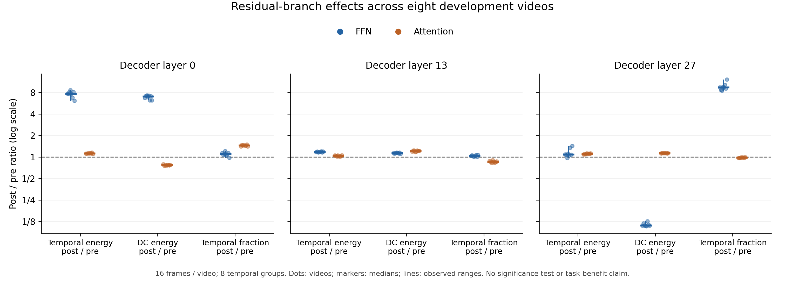

# 原八视频：FFN 与注意力残差的开发诊断

本报告使用原 8 个开发视频，每个 16 帧、8 个隐藏时间位置，固定 Qwen3-VL-2B 的 decoder 0/13/27 层。只描述表示变化，不进行显著性检验，不评估问答或记忆收益。

源视频、帧字节、模型/revision/BF16、时间网格、原 dtype 的 token 级残差恒等式、NPZ 与源码快照均已逐项核查。各次源码版本见 JSON；首个工程试点与后续强化检查的源码并不完全相同。

最后一层 FFN 的时间占比中位数变为 9.442 倍，但绝对时间能量仅变为 1.083 倍，DC 变为 0.110 倍。全部 8 个视频都出现占比上升伴随 DC 下降；其中 1 个视频的绝对时间能量没有上升。这提示归一化占比受 DC 抵消强烈影响，不能把占比倍数当成有用动态信息增益。

这针对的是把 DC 纳入分母的诊断指标。冻结 v1 的 spectral_balanced 目标已经去均值、排除 DC；**当前观察不能解释 v1 的失败，也没有证明某个改动能够修复它。**

## 中位数与实际范围

每格为中位数 [最小值, 最大值]；这些范围不是置信区间。比值大于 1 表示残差合并后增大。

| 层 | 路径 | 时间能量 post/pre | DC post/pre | 时间占比 post/pre | 总能量 post/pre | 时间占比变化 pp |
| ---: | --- | --- | --- | --- | --- | --- |
| 0 | Attention | 1.1270 [1.1010, 1.1478] | 0.7734 [0.7523, 0.7896] | 1.4535 [1.4067, 1.4898] | 0.7787 [0.7587, 0.7941] | 0.7766 [0.4672, 0.8355] |
| 0 | FFN | 7.6753 [6.1000, 8.5782] | 7.0561 [6.2230, 7.2605] | 1.0995 [0.9786, 1.2128] | 7.0859 [6.2333, 7.2726] | 0.1987 [-0.0614, 0.5536] |
| 13 | Attention | 1.0363 [1.0140, 1.0625] | 1.2216 [1.1700, 1.2343] | 0.8560 [0.8272, 0.9033] | 1.2170 [1.1667, 1.2297] | -0.3550 [-0.4306, -0.2716] |
| 13 | FFN | 1.1758 [1.1621, 1.1966] | 1.1357 [1.1083, 1.1569] | 1.0337 [1.0118, 1.0731] | 1.1363 [1.1102, 1.1572] | 0.0713 [0.0255, 0.1707] |
| 27 | Attention | 1.1108 [1.0900, 1.1233] | 1.1300 [1.1269, 1.1377] | 0.9832 [0.9674, 0.9920] | 1.1300 [1.1267, 1.1376] | -0.0081 [-0.0191, -0.0058] |
| 27 | FFN | 1.0832 [0.9693, 1.4258] | 0.1101 [0.1073, 0.1258] | 9.4422 [8.4345, 12.0911] | 0.1168 [0.1117, 0.1315] | 4.3187 [3.7789, 6.9890] |

## 归一化占比与 DC 抵消

令 V 为去时间均值后的能量，D 为 DC 能量，时间占比为 f=V/(V+D)。精确有 f_post/f_pre=(V_post/V_pre)/((V_post+D_post)/(V_pre+D_pre))。因此，占比大幅提高并不要求绝对时间能量大幅提高。

| 视频 | 层 | 路径 | 时间能量比 | DC 比 | 总能量比 | 时间占比比 | DC 交叉项 |
| --- | ---: | --- | ---: | ---: | ---: | ---: | ---: |
| video_10993 | 0 | Attention | 1.1171 | 0.7896 | 0.7941 | 1.4067 | -0.0396692 |
| video_10993 | 0 | FFN | 7.6957 | 6.7131 | 6.7323 | 1.1431 | 0.160088 |
| video_1580 | 0 | Attention | 1.1158 | 0.7523 | 0.7587 | 1.4706 | -0.0425581 |
| video_1580 | 0 | FFN | 7.6549 | 7.1568 | 7.1698 | 1.0677 | 0.149114 |
| video_2564 | 0 | Attention | 1.1378 | 0.7749 | 0.7786 | 1.4614 | -0.0426617 |
| video_2564 | 0 | FFN | 8.0799 | 7.2605 | 7.2726 | 1.1110 | 0.173531 |
| video_3501 | 0 | Attention | 1.1282 | 0.7615 | 0.7680 | 1.4691 | -0.0401021 |
| video_3501 | 0 | FFN | 8.5782 | 7.0326 | 7.0728 | 1.2128 | 0.141435 |
| video_6860 | 0 | Attention | 1.1324 | 0.7785 | 0.7847 | 1.4431 | -0.0398889 |
| video_6860 | 0 | FFN | 7.6513 | 7.2451 | 7.2554 | 1.0546 | 0.159676 |
| video_8241 | 0 | Attention | 1.1258 | 0.7726 | 0.7788 | 1.4456 | -0.0406602 |
| video_8241 | 0 | FFN | 6.7855 | 6.2230 | 6.2372 | 1.0879 | 0.144207 |
| video_874 | 0 | Attention | 1.1478 | 0.7657 | 0.7704 | 1.4898 | -0.0407296 |
| video_874 | 0 | FFN | 8.1361 | 7.0797 | 7.0989 | 1.1461 | 0.148489 |
| video_9253 | 0 | Attention | 1.1010 | 0.7742 | 0.7809 | 1.4100 | -0.0399092 |
| video_9253 | 0 | FFN | 6.1000 | 6.2372 | 6.2333 | 0.9786 | 0.143475 |
| video_10993 | 13 | Attention | 1.0518 | 1.1933 | 1.1899 | 0.8840 | 0.734968 |
| video_10993 | 13 | FFN | 1.1711 | 1.1328 | 1.1336 | 1.0330 | 0.573252 |
| video_1580 | 13 | Attention | 1.0459 | 1.2343 | 1.2297 | 0.8506 | 0.913091 |
| video_1580 | 13 | FFN | 1.1866 | 1.1142 | 1.1157 | 1.0636 | 0.498588 |
| video_2564 | 13 | Attention | 1.0140 | 1.2309 | 1.2258 | 0.8272 | 0.881086 |
| video_2564 | 13 | FFN | 1.1650 | 1.1386 | 1.1391 | 1.0228 | 0.611318 |
| video_3501 | 13 | Attention | 1.0539 | 1.1700 | 1.1667 | 0.9033 | 0.646581 |
| video_3501 | 13 | FFN | 1.1709 | 1.1569 | 1.1572 | 1.0118 | 0.688527 |
| video_6860 | 13 | Attention | 1.0219 | 1.1906 | 1.1864 | 0.8614 | 0.751684 |
| video_6860 | 13 | FFN | 1.1805 | 1.1405 | 1.1413 | 1.0343 | 0.63701 |
| video_8241 | 13 | Attention | 1.0201 | 1.2277 | 1.2223 | 0.8346 | 0.836063 |
| video_8241 | 13 | FFN | 1.1966 | 1.1210 | 1.1226 | 1.0659 | 0.49358 |
| video_874 | 13 | Attention | 1.0268 | 1.2182 | 1.2135 | 0.8461 | 0.825015 |
| video_874 | 13 | FFN | 1.1621 | 1.1479 | 1.1482 | 1.0121 | 0.642513 |
| video_9253 | 13 | Attention | 1.0625 | 1.2249 | 1.2205 | 0.8706 | 0.83835 |
| video_9253 | 13 | FFN | 1.1913 | 1.1083 | 1.1102 | 1.0731 | 0.441204 |
| video_10993 | 27 | Attention | 1.0900 | 1.1269 | 1.1267 | 0.9674 | 138.157 |
| video_10993 | 27 | FFN | 1.0873 | 0.1094 | 0.1149 | 9.4615 | -2228.54 |
| video_1580 | 27 | Attention | 1.0991 | 1.1325 | 1.1324 | 0.9706 | 147.888 |
| video_1580 | 27 | FFN | 1.0702 | 0.1185 | 0.1232 | 8.6890 | -2147.22 |
| video_2564 | 27 | Attention | 1.0983 | 1.1296 | 1.1295 | 0.9724 | 144.923 |
| video_2564 | 27 | FFN | 0.9693 | 0.1105 | 0.1149 | 8.4345 | -2309.25 |
| video_3501 | 27 | Attention | 1.1208 | 1.1299 | 1.1298 | 0.9920 | 146.072 |
| video_3501 | 27 | FFN | 1.1135 | 0.1085 | 0.1158 | 9.6197 | -2309.34 |
| video_6860 | 27 | Attention | 1.1116 | 1.1302 | 1.1301 | 0.9836 | 145.299 |
| video_6860 | 27 | FFN | 1.0525 | 0.1073 | 0.1117 | 9.4229 | -2252.84 |
| video_8241 | 27 | Attention | 1.1130 | 1.1326 | 1.1325 | 0.9828 | 160.906 |
| video_8241 | 27 | FFN | 1.3447 | 0.1258 | 0.1315 | 10.2290 | -2264.96 |
| video_874 | 27 | Attention | 1.1101 | 1.1269 | 1.1269 | 0.9851 | 141.907 |
| video_874 | 27 | FFN | 1.0792 | 0.1135 | 0.1187 | 9.0878 | -2207.57 |
| video_9253 | 27 | Attention | 1.1233 | 1.1377 | 1.1376 | 0.9875 | 158.114 |
| video_9253 | 27 | FFN | 1.4258 | 0.1096 | 0.1179 | 12.0911 | -2314.91 |

DC 交叉项是 2Re〈残差 DC, 增量 DC〉，负值可以抵消原均值分量；它与增量自身能量和舍入项共同决定输出 DC。不能将 DC 自动命名为背景，也不能把抵消写成删除无用信息。

## 解释边界

- 每个视频都保留，不筛选有利层或有利样本；没有独立确认、QA 成绩、因果干预或长期记忆收益。
- Attention 与 FFN 使用各自正确残差输入；FFN 的归一化输入不是未归一化残差。
- 原 dtype 恒等式在全部视觉 token 上核查；频谱指标基于空间均值，仍可能隐藏局部动态。
- T=8 只有四个非 DC 频率 bin，物理频率随片段时长变化，不能给三个频带赋予固定语义。
- 资源监控成功不能证明先前系统重启原因已经修复；遥测采样可能遗漏短峰值。

## 本次实测资源

- 八次运行中最大 CUDA allocated 峰值：4,363,261,440 bytes；reserved 峰值：4,410,310,656 bytes。
- 2 秒采样观察到的最高 GPU 温度：50°C；最大进程 RSS：5,008,572,416 bytes；最低可用 RAM：17,004,007,424 bytes。
- 这些是本批运行的已观察值，不是未来运行或整机资源的保证上限。CUDA allocated/reserved 不包括所有驱动显存；2 秒采样可能遗漏短暂温度及系统内存峰值。

图中小点是全部视频，粗标记是中位数，竖线是实际最小到最大范围；不是标准误或置信区间。
